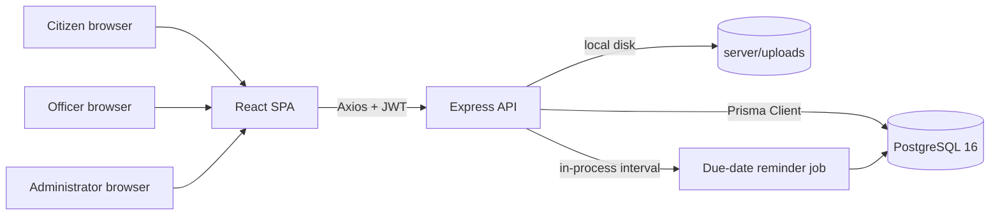

# Architecture

## Context

Amaravati One is a pilot for a unified citizen services super app for the APCRDA region. It combines three products in
one deployment:

1. A citizen portal for discovering services, applying, tracking outcomes, holding credentials, paying fees and
   receiving nudges.
2. An officer workbench for reviewing assigned applications and deciding outcomes.
3. An administrator console for the service catalogue, citizens, payments, obligations, communications and reporting.

The implementation is a classic decoupled monorepo: a React single-page application talks to an Express JSON API, which
owns all business rules and persists to PostgreSQL through Prisma.

## System diagram



## Repository boundaries

| Path | Responsibility |
| --- | --- |
| `client/src/pages` | Route-level screens grouped by role |
| `client/src/components` | Layout shells, role-aware navigation, shared UI primitives |
| `client/src/context` | Authentication session state |
| `client/src/lib` | Axios client, token storage, formatting helpers |
| `server/src/routes` | HTTP contracts, validation and authorisation boundaries |
| `server/src/services` | Cross-cutting domain services (reminder engine) |
| `server/src/middleware` | Authentication, role checks, zod validation, uploads, error handling |
| `server/src/utils` | Token signing, notification creation, audit logging, reference generation |
| `server/prisma` | Schema, migration history, deterministic demo seed |

There is no shared package between client and server. The contract is the JSON API documented in
[api.md](api.md). This keeps each side independently deployable and avoids coupling build tooling.

## Backend layering

A request follows this path:

1. `helmet`, CORS, JSON parsing and request logging.
2. Static `/uploads` serving for documents.
3. Route-specific middleware: `authenticate`, then `authorize(...roles)`, then `validate(schema)`.
4. Route handler performs Prisma work, emits notifications and writes an audit entry.
5. Errors flow to the central error handler, which normalises application, validation, Prisma and multer failures.

The route layer intentionally contains the business rules for this pilot. If the domain grows, the next refactor is to
extract use-case services while keeping route modules as thin adapters.

### Authentication and authorisation

- Passwords are hashed with bcrypt (10 rounds).
- Successful login or registration returns a JWT signed with `JWT_SECRET`, valid for `JWT_EXPIRES_IN` (default 7 days).
- The client stores the token in `localStorage` under `amaravati_token` and attaches `Authorization: Bearer <token>` via
  an Axios request interceptor.
- `authenticate` re-reads the user on every request, so deactivation takes effect immediately and profile data is fresh.
- `authorize(...roles)` checks the role after authentication.
- Object-level access is checked in route helpers:
  - Citizens can only read their own applications and payments.
  - Officers can only open applications assigned to them.
  - Administrators can read all applications and payments.
- A 401 triggers the client to clear the session and return to sign-in.

### Role capability matrix

| Capability | Citizen | Officer | Administrator |
| --- | --- | --- | --- |
| Browse active services | Yes | Yes | Yes |
| Create application | Yes | No | No |
| Upload applicant documents | Owner | No | Yes |
| Verify documents | No | Assigned files | Any file |
| Change application status | No | Assigned files | Any file |
| Resubmit after correction | Owner | No | No |
| Assign officer | No | No | Yes |
| Manage service catalogue | No | No | Yes |
| Manage citizens | No | No | Yes |
| View all payments / receipts | Own only | No | Yes |
| Broadcast notifications | No | No | Yes |
| Manage due dates | Own completion | No | Full CRUD + reminders |
| Reports and audit log | No | No | Yes |

## Key domain flows

### Application submission

1. Citizen selects an active service and provides `formData`.
2. The API generates a readable reference using `nextApplicationReference()` (`AMA-YYYY-NNN`).
3. The application is created in `SUBMITTED` with an initial status-history row.
4. If the service fee is greater than zero, a `PENDING` payment is created automatically.
5. A status-update notification is sent to the citizen.
6. An audit entry records the submission.

### Document handling

- Uploads are multipart form data with field name `file` and optional `documentType`.
- Allowed MIME types: PDF, JPEG, PNG and plain text; maximum 5 MB.
- Files land in `server/uploads` with a randomised name and are served at `/uploads/<name>`.
- The database stores `filePath` as `uploads/<name>`; the client resolves it with the API origin.
- Officers and administrators can verify or flag a document. The citizen is notified and an audit entry is written.

### Status workflow

```text
SUBMITTED -> DOCUMENTS_VERIFIED -> UNDER_REVIEW -> APPROVED
                                           \--> REJECTED
SUBMITTED/UNDER_REVIEW -> CORRECTION_REQUESTED -> SUBMITTED (citizen resubmit)
```

- Only officers (assigned) and administrators can change status.
- Every transition writes a status-history row with optional remarks and the acting user.
- Decisions stamp `decidedAt`.
- Requesting a correction creates an `APPLICATION_ACTION` due date five days out.
- Approval or rejection completes any open correction due date for that reference.
- Resubmission completes the correction due date, notifies the assigned officer and returns the file to `SUBMITTED`.

### Officer assignment

- Admin assignment deactivates previous active assignment rows, creates a new `OfficerAssignment`, and updates the
  denormalised `assignedOfficerId` on the application for fast queue queries.
- The officer receives an in-app notification with a deep link to the file.

### Digital wallet verification

- Citizens add credential metadata; new credentials start as `PENDING`.
- Verification is simulated: the endpoint records a `CredentialVerification` row, marks the credential `VERIFIED` and
  stamps `verifiedAt`.
- The list endpoint computes an `effectiveStatus`: a verified credential whose `expiresAt` has passed is presented as
  `EXPIRED` without mutating stored history.
- The UI clearly labels the sandbox behaviour.

### Payments

- Application fees create `PENDING` payments automatically. A citizen may also create a standalone payment.
- Confirmation simulates a UPI collect: it generates a transaction ID, stores the submitted UPI ID and stamps `paidAt`.
- Completing a payment closes any due date whose `referenceId` matches the application reference.
- Success and failure both notify the citizen and write audit entries.
- Receipts are server-rendered HTML with a print-friendly stylesheet and a `?print=1` auto-print option.
- Access rules allow the payment owner or any administrator.

### Due dates and reminders

- Administrators create obligations with type, due date, optional amount and reference ID.
- `runDueDateReminders` selects open obligations with no `reminderSentAt`, due between now and `withinDays`.
- For each, it notifies the citizen and stamps `reminderSentAt`, making the job effectively idempotent per obligation.
- Citizens can trigger a personal 30-day sweep (`POST /due-dates/remind-me`).
- Administrators can trigger a 7-day sweep on demand.
- The API also runs an in-process daily interval (`setInterval(...).unref()`) so the pilot behaves autonomously. A
  production deployment should move this to a durable scheduler.

### Notifications and audit

- `notifyUser` inserts a notification row. There is no external delivery channel in the pilot.
- Broadcasts fan out one row per active citizen.
- `recordAudit` captures actor, action, entity, entity ID, metadata and IP address for administrative traceability.

## Frontend architecture

### Routing

`App.jsx` defines three guarded branches:

- `/app/*` for citizens, rendered inside the citizen `AppLayout`.
- `/admin/*` for administrators.
- `/officer/*` for officers.
- Public routes: landing, sign-in, registration, password recovery.

`ProtectedRoute` waits for the session bootstrap, redirects unauthenticated users to `/login`, and redirects users who
lack the required role to their own home route.

### Session state

`AuthProvider`:

- Hydrates the user from `localStorage` and calls `GET /auth/me` when a token exists.
- Exposes `login`, `register`, `logout`, `refresh` and `updateUser`.
- Stores the latest sanitized user returned by the API so profile edits and OTP verification update the UI immediately.

### Data fetching

Screens call the API directly with small `load()` helpers and local component state. This is deliberate for a pilot:
each page owns its query, loading state and error handling without an extra state library. The pattern is consistent and
easy to replace with React Query later.

### UI system

- Tailwind theme tokens: navy `#0B1F3A`, teal `#0E9F9F`, saffron `#F59E0B`, off-white `#F6F8FB`.
- Shared primitives in `components/ui.jsx`: buttons, cards, badges, alerts, fields, modals, stat cards, progress bars,
  empty states and loading blocks.
- `AppLayout` supplies a responsive sidebar, mobile navigation, notification badge and role switch-aware links.
- `ToastProvider` gives success, error and info feedback without blocking the page.

## Security posture

Implemented:

- Password hashing, JWT verification, active-account checks, role gates, object-level ownership checks.
- Request body validation with zod, central error handling, upload MIME and size limits.
- Helmet security headers, explicit CORS allow-list, audit trail for privileged actions.
- No secrets in source; `.env` is ignored.

Deliberately simulated or deferred for the pilot:

- UPI, Aadhaar, DigiLocker and OTP providers.
- Rate limiting, refresh-token rotation, CSRF protection (the API is token-only and not cookie-based), email delivery,
  virus scanning for uploads, object storage, and production-grade job scheduling.
- Local storage of JWTs is acceptable for the demo but should be replaced with short-lived access tokens plus secure
  refresh handling in production.

## Extension points

- Replace simulated verification adapters behind the existing credential endpoints.
- Add a payment provider callback route and reconcile `Payment` rows by `referenceNo`.
- Extract the reminder engine into a scheduled worker and add retry/backoff.
- Introduce React Query and generated API types from an OpenAPI specification.
- Add document preview, signed URLs and malware scanning.
- Add accessibility and localisation passes (English and Telugu) before field pilots.
